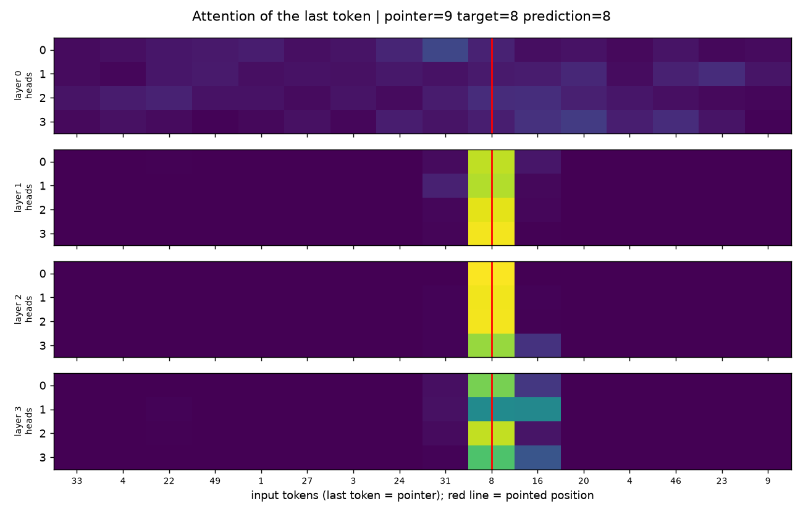

# Transformer from Scratch (PyTorch)

A decoder-style Transformer written from first principles in PyTorch: embeddings, sinusoidal positional encoding, multi-head causal self-attention, pre-norm residual blocks, and a training loop with AdamW, cosine schedule, gradient clipping, optional mixed precision, and checkpointing. Nothing comes from `torch.nn.MultiheadAttention` or `nn.Transformer`. Every tensor shape is annotated, and each design choice is explained inline.

The goal is a compact codebase you can read in one sitting, plus a synthetic task where you can **see** attention doing its job.



*After training, the last token (a pointer) attends almost entirely to the position it points to (red line) in layers 1–3, while layer 0 is still diffuse.*

## Results

The default **pointer task** needs content-based addressing: the last token is an index `k`, and the model must output the token at position `k`. That is exactly what attention plus positional encoding is for.

| Setting | Value |
|---|---|
| Model | 4 layers, 4 heads, d_model 64, FFN 256, ~0.2M parameters |
| Data | 20,000 train / 1,000 validation sequences, length 16, vocabulary 50 |
| Training | 20 epochs, AdamW (lr 1e-3, wd 0.01), cosine decay, batch 64 |
| Validation accuracy | **100%** (reached at epoch 8; chance level is 2%) |
| Runtime | under a minute on an Apple M-series GPU (MPS) |

The full log is in [`assets/train_log.txt`](assets/train_log.txt).

**A note on the second task.** `task="mod_sum"` (target = `(last + second_last) % 50`) looks easier but is a classic *grokking* problem. With the default budget the model stays at chance level (~2.5% validation accuracy after 10 epochs); small Transformers generally need thousands of epochs and strong weight decay to generalize on modular arithmetic. It is kept as an exercise.

## Project structure

```text
model.py               Positional encoding, multi-head self-attention, FFN, pre-norm block, backbone, head
dataset.py             Synthetic tasks ("pointer", "mod_sum") and DataLoaders
loss.py                Cross-entropy wrapper
trainer.py             Train/eval loops, accuracy, AMP, gradient clipping, checkpoints
main.py                Wires everything together; picks CUDA, MPS (Apple) or CPU automatically
visualize_attention.py Plots the last token's attention for each layer and head
docs/README_TR.md      Original long-form tutorial (Turkish)
```

## Quick start

```bash
python -m venv .venv && source .venv/bin/activate
pip install -r requirements.txt
python main.py                 # trains, logs val accuracy, saves checkpoints/best.pt
python visualize_attention.py  # writes assets/attention.png
```

Configuration lives in the dataclasses `DatasetConfig`, `ModelConfig` and `TrainConfig`. To try the grokking task, set `task="mod_sum"` in `DatasetConfig`.

## Implementation notes

- **Attention from scratch:** one fused `qkv` projection, reshape to `(B, H, N, Hd)`, scaled dot product, cached causal mask, max-subtracted softmax for numerical stability, `finfo.min` masking so it stays safe under mixed precision.
- **Pre-norm blocks** (`x + attn(LN(x))`, `x + ffn(LN(x))`) keep gradients well-behaved as depth grows.
- **Sinusoidal positions** add no parameters; they're registered as a non-persistent buffer.
- **Training hygiene:** seeded RNGs, deterministic synthetic data, gradient clipping at 1.0, `set_to_none=True` gradient clearing, best and periodic checkpoints.

A longer, step-by-step walkthrough of each component (in Turkish) is in [`docs/README_TR.md`](docs/README_TR.md).

## License

MIT. See [LICENSE](LICENSE).
